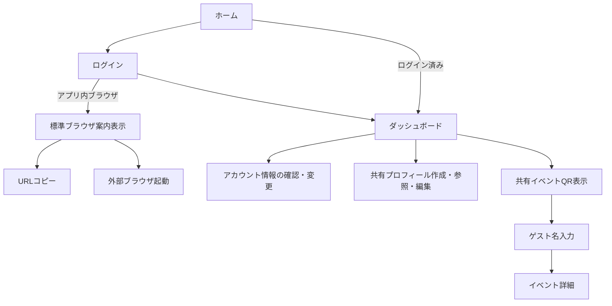
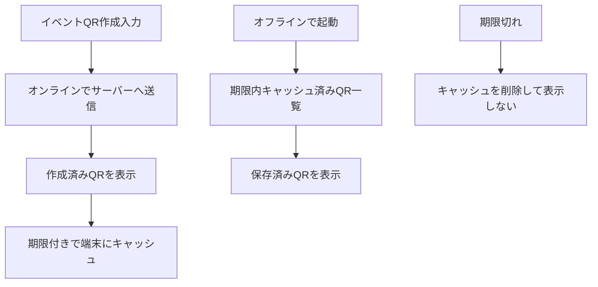

# 1G1A Site Map and Screen Structure

このドキュメントは、1G1A の画面構成、主要導線、各画面の表示項目を整理するための設計メモです。
公開リポジトリに置く前提のため、サーバー固有のホスト名、IP、実ディレクトリ、秘密情報は記載しません。

## 前提

- 現在の実装は PHP + HTML + CSS + JavaScript のフレームワークなし構成。
- ログイン画面とログイン後のユーザー画面は、すべてPWAとして構成する。
- QR表示画面は、共有イベント作成直後だけでなくイベント一覧から再表示する場合もPWA内で扱う。
- オフライン利用では、端末にキャッシュ済みで期限内の作成済みQRを表示できる。
- ゲスト公開ページはPWAとしてインストールさせる対象にはしない。QRから通常のWebページとして閲覧し、利用時は完全オンライン前提とする。

## サイトマップ

### 画面構成

1G1A の画面は「公開・認証前」「ログイン後」「ゲスト公開」の3系統で構成する。

公開・認証前は、サービス入口、ログイン、認証処理、ログアウト、ヘルスチェックで構成する。

ログイン後は、ダッシュボード、アカウント情報の確認・変更、共有プロフィール作成・参照・編集、新着情報、QR表示で構成し、すべてPWA内の画面として扱う。
共有プロフィールは、ダッシュボードの共有プロフィール一覧から編集画面へ進み、参照と編集を同じ画面内で扱う。
ダッシュボードでは下線付きのタブで共有プロフィールを切り替え、選択中のプロフィールを色と下線で示す。設定メニューはヘッダー右上に歯車アイコンと「メニュー」ラベルで表示する。共有プロフィール管理、基本プロフィール、新着情報、ログアウトは設定メニューに置き、メニュー下部にアプリバージョンを表示する。

ゲスト公開は、QRからアクセスしたゲストが、ログインなしで共有イベントを閲覧する画面として構成する。
ゲスト公開はPWA登録対象外とする。
ゲスト公開は完全オンライン前提とし、端末内保存やオフライン再送は行わない。
ゲスト側のCookieや保存状態は、共有イベントごとに分離する。

### 公開・認証前

| URL | 画面名 | 役割 |
| --- | --- | --- |
| `/` | ホーム | サービス入口。未ログインユーザー向けの概要表示。ログイン済みユーザーはダッシュボードへ遷移する。 |
| `/login` | ログイン | Google ログインの入口。アプリ内ブラウザなどGoogle認証が失敗しやすい環境では、標準ブラウザで開く案内を表示する。 |
| `/auth/google` | Google認証開始 | Google OAuth へ遷移する処理。画面ではなく認証処理。 |
| `/auth/google/callback` | Google認証戻り | Google OAuth の戻り処理。画面ではなく認証処理。 |
| `/logout` | ログアウト | セッションを破棄してホームへ戻す処理。 |
| `/healthz` | ヘルスチェック | サーバー稼働確認用。 |

### ログイン後

| URL | 画面名 | 役割 |
| --- | --- | --- |
| `/dashboard` | ダッシュボード | 共有プロフィール選択、イベントQR作成、最近の共有イベント確認の中心画面。 |
| `/account` | アカウント情報の確認・変更 | ユーザー自身のアカウントプロフィール画像、名称、Google認証情報を確認・変更する画面。 |
| `/news` | 新着情報 | 運営が公開したニュースリリースをログインユーザーへ表示する。設定メニューから開く。 |
| `/news/manage` | 新着情報の管理 | `admin` ロールの運営担当がニュースリリースを作成、編集、公開、削除する。 |
| `/profiles` | 共有プロフィール一覧 | 共有プロフィールの追加・編集画面へ進む管理画面。 |
| `/profiles/new` | 共有プロフィール作成 | 相手に見せる共有プロフィールを作成する画面。 |
| `/profiles/{id}` | 共有プロフィール参照・編集 | 互換用。アクセス時は `/profiles/{id}/edit` へ遷移する。 |
| `/profiles/{id}/edit` | 共有プロフィール参照・編集 | 既存の共有プロフィールを確認・編集する画面。 |
| `/share-events/{id}/qr` | QR表示 | 作成済みで有効期限内の共有イベントQRを表示する。オンライン中に表示したQRは端末へキャッシュし、期限内に限りオフラインでも再表示できる。 |

### ゲスト公開

| URL | 画面名 | 役割 |
| --- | --- | --- |
| `/s/{share_event_token}` | 共有イベント公開ページ | QRを読んだゲストが見る画面。ゲスト名入力画面とイベント詳細画面の2画面で構成する。 |
| `/media/{filename}` | メディア配信 | アップロード済み画像を返す。画面ではなく画像配信処理。 |

### 非同期処理・API

| URL | 用途 | 呼び出し元 |
| --- | --- | --- |
| `POST /share-events/create` | オンラインで共有イベントと、利用者が許可した場合の位置情報を保存する。 | ダッシュボード。 |
| `GET /version.json` | 現在の固定アプリバージョンを返す。キャッシュしない。 | インストール済みPWAの起動処理。 |
| `POST /pwa/session` | PWAセッションCookieを90日有効にする。 | インストール済みPWA。 |

アプリのバージョンはリポジトリ直下の `VERSION` で管理し、初期値は `0.0.1` とする。リリース時に番号を上げると、PWA起動時の比較とService Workerの更新に反映される。通常ブラウザーのセッションCookieはブラウザー終了時に失効し、インストール済みPWAだけ90日間保持する。

## 画面構成

### ホーム

目的:
サービスの入口。ログイン前のユーザーに、1G1A が「相手に見せるプロフィールとその場のメッセージをQRで渡すサービス」であることを伝える。
ログイン済みユーザーがアクセスした場合は、ホームを表示せずダッシュボードへ遷移する。

表示項目:

- サービス名
- サービス概要
- ログイン導線

主な操作:

- ログイン画面へ進む

遷移:

- 未ログインの場合はホームを表示する
- ログイン済みの場合は `/dashboard` へ遷移する

### ログイン

目的:
Googleアカウントでログインする。
この画面はPWAの入口として扱う。
LINEなどのアプリ内ブラウザや、Google OAuth が失敗しやすいブラウザで開かれた場合は、Googleログインを直接開始させず、標準ブラウザで開くための案内を表示する。

表示項目:

- Googleログインボタン
- ログインできない場合の案内

アプリ内ブラウザ判定時の表示項目:

- 標準ブラウザで開く必要があることの案内
- 現在のURLをコピーするボタン
- Android向けの外部ブラウザ起動用リンク
- iPhone向けの、LINEなどのメニューから「ブラウザで開く」操作を促す案内

主な操作:

- Google OAuth 開始
- 現在のURLをコピーする
- Androidで外部ブラウザ起動用リンクを開く

注意:

- メールアドレスやGoogle IDはゲスト画面には出さない。
- アプリ内ブラウザ判定時は、Googleログインボタンをそのまま表示しない。
- iPhoneではWebページ側からSafariなどの標準ブラウザへ確実に自動遷移させることはできないため、手順案内を基本にする。
- Androidの外部ブラウザ起動用リンクは、端末やアプリの制限により動作しない場合があるため、URLコピー手段も必ず用意する。
- 共有イベント公開ページはログイン不要のため、アプリ内ブラウザでも閲覧を止めない。

### ダッシュボード

目的:
ログイン後の中心画面。会った相手に見せるプロフィールを選び、その場のメッセージや写真を付けてQRを作る。
この画面はPWA内の中心画面として扱う。

表示項目:
表示順はここで出てきた順を基本とする

- ヘッダ
　- アカウントプロフィールアイコン
    - クリックするとアカウント情報の確認・変更画面を開く
  - ログアウト導線
  - PWAインストール導線
    - (PWA)インストール後は非表示

- 共有ブロック
  - 共有プロフィール選択
  - 共有メッセージ
  - 共有写真追加
    - カメラ起動、アルバム選択
  - 共有QRの有効期限選択
  - 表示想定人数
    - 数値入力とする
    - デフォルト値は `3` とする
    - 1以上の整数を入力する
    - 表示想定人数は、このイベントを見せる予定の実人数として扱う
    - 将来、この値が設定されている場合は、イベントごとのユニークゲストアクセス数が「表示想定人数 × 3」以上になった時点でアクセスを制限する
    - ユニークゲストアクセス数はページ表示回数ではなく、イベント別Cookieのゲスト識別IDを基準に数える
    - 1人がPCやスマートフォンなど最大3端末・ブラウザからアクセスする想定で、表示想定人数に3を掛ける
    - アクセス制限機能と制限時画面は今回は実装せず、将来対応とする
  - 位置情報をつける
    - ON/OFFのスライダートグルで表示し、デフォルトはONとする
    - ブラウザで位置情報を利用でき、サイト単位で拒否済みでない場合に操作可能にする
    - 位置情報が許可済みの場合は、トグルのすぐ下に「位置情報をつけると地図を添付できます」と表示する
    - 位置情報が拒否済み、またはブラウザで利用できない場合はトグルを無効化する
    - トグルが無効な場合は、その下に「位置情報を許可すると使えます」と表示する
    - 位置情報が許可済みの場合は「位置情報を許可すると使えます」を表示しない
    - ONの場合だけイベントの初回作成時に位置情報を取得・保存し、OFFの場合は取得しない。イベント一覧からQRを再表示するときは位置情報を取得・更新しない
  - 共有QR作成ボタン

- 共有プロフィール一覧ブロック
  - 編集画面への導線のみ表示する
  - 共有プロフィール単体のQR表示導線は持たせない

- 最近の共有イベント一覧ブロック
  - ページング有効　５件づつ表示
  - クリックすると共有イベント用のQRコード画面を開く
  - その後ユーザ自身がurlから入った場合は名前を聴いてこないようにすぅる

主な操作:

- オンラインで共有イベントを作成し、サーバー保存後にQRを表示する
- プロフィール管理・編集と写真送信にはオンライン接続を必要とする
- Service Worker がダッシュボード上の有効なイベントQRを先読みする
- オフライン時はキャッシュ済みで期限内のイベントQR一覧とQR表示だけを利用できる
- 期限切れQR、未キャッシュQR、ゲスト向け共有ページはオフライン表示しない

### アカウント情報の確認・変更

目的:
ユーザーアカウントにひもづく基本情報を確認・変更する。ヘッダのアカウントプロフィールアイコンから開く。
アルファ版では、課金や長期的なアカウント引き継ぎに使う固有ID連携は行わない。

表示項目:

- アカウントプロフィール画像
  - 未登録の場合はデフォルトの画像を用意しておいてそれを使う
  - 10種類ぐらい作って初回登録でランダムにする
- アカウントの名称
- Google認証情報
  - メールアドレス
- 保存ボタン
- 公開されない情報の説明

主な操作:

- アカウントプロフィール画像を設定する
- アカウントの名称を保存する

変更できない項目:

- Google認証情報
- メールアドレス

注意:

- アカウントプロフィール画像は、ユーザーアカウントに紐づく画像として扱う。
- アカウントプロフィール画像が未登録の場合は、初回登録時にデフォルト画像候補からランダムに1つを割り当てる。
- Google認証情報は確認用に表示するが、この画面では変更できない。
- メールアドレスやGoogle IDはゲスト画面には出さない。
- アルファ版では、アカウントを使い捨てても成立する前提にする。
- 課金や長期利用を扱う段階で、サービス側の固有IDや外部認証との連携設計を追加する。

### 共有プロフィール作成・参照・編集

目的:
相手に見せるプロフィールを用途別に作り、既存プロフィールの内容確認と編集を同じ画面で扱う。仕事用、趣味用、イベント用などを分けられるようにする。

表示項目:

- 管理用プロフィール名
- 表示名
- プロフィール画像
  - 共有プロフィール画像が未設定の場合は、アカウントプロフィール画像を表示する
  - 共有プロフィール画像を削除した場合も、アカウントプロフィール画像を表示する
- 見出し
- 自己紹介
- 利用状態
- SNS/外部リンク一覧
  - 登録済みの連絡先だけを表示する
  - 各行にサービスアイコン、サービス名、入力値、削除ボタンを表示する
- 連絡先追加ボタン
  - 押すと追加モーダルまたはボトムシートを表示する
  - 追加候補はSNS/連絡先種類マスタから取得する
  - アイコンを縦横グリッドで表示する
  - 未登録アイコンを押すと、そのサービスの入力欄をプロフィール編集画面へ追加する
  - 登録済みアイコンを押した場合は、該当入力欄へスクロールする
  - 削除は入力欄側の削除ボタンで行う
- 最近の共有イベント
- イベント写真
- 保存ボタン

主な操作:

- 共有プロフィールを作成する
- 共有プロフィールを参照する
- 共有プロフィールを更新する
- プロフィール画像をアップロードする
- SNS/外部リンクを追加する
- SNS/外部リンクを更新する
- SNS/外部リンクを削除する
- 利用状態を切り替える

注意:

- プロフィール画像はURL手入力ではなく、端末からのアップロードを基本にする。
  - カメラ起動またはアルバムから選択できるようにする
  - 初回追加時や削除したときはアカウントプロフィール画像を表示する
- 共有プロフィール画像が未設定の場合に表示するアカウントプロフィール画像は、あくまで表示上のフォールバックとして扱う。
- 共有プロフィール画面でプロフィール画像を削除しても、共有プロフィールに設定された画像だけを削除し、元のアカウントプロフィール画像は削除しない。
- 共有イベント画面やQR中央に表示する画像も、共有プロフィール画像があればそれを使い、なければアカウントプロフィール画像を使う。
- 共有プロフィール単体の公開URLは持たせない。
- ゲストは共有イベントURLからのみ、共有イベントに紐づくプロフィール情報を見る。
- 既存プロフィールの参照と編集は別ページに分けず、同じ編集画面内で扱う。
- 共有プロフィール画面からQR表示へ進む導線は持たせない。QRは共有イベント作成後または共有イベント一覧から再表示する。

### QR表示

目的:
共有イベント作成直後またはイベント一覧から開き、相手に見せるQRを大きく表示する。通信が不安定でも、相手が画面を写真に撮って後からアクセスできるようにする。
この画面はPWA内の画面として扱う。
再表示させることもあるため、ユーザーのイベント一覧をクリックしても表示できるようにする。
この画面では共有イベントの本文、写真、状態などの詳細情報は表示しない。
イベント詳細の表示は、QR遷移後のゲスト公開ページで行う。

表示項目:

- 共有プロフィール名
- QRコード
  - QRコードの中心には、共有プロフィール画像があればそれを表示する
  - 共有プロフィール画像が未設定の場合は、アカウントプロフィール画像を表示する
  - アカウントプロフィール画像は初回登録時にデフォルト画像候補からランダムに1つ割り当てるため、QR中央には原則としてアカウント側の画像を表示する
- 短い説明文
- 英語の補助説明
- URL

主な操作:

- 共有イベントQRを相手に見せる
- ダッシュボードの共有イベント一覧からQRを再表示する
- URLを開く

注意:

- 位置情報取得に失敗してもQR表示は止めない。
- 共有イベント作成時に、利用者が許可した場合だけ位置情報を保存する。
- QR表示はオンラインで保存が成功してから行い、再表示時に位置情報を再取得しない。
- 期限内の作成済みQRをオンラインで表示した場合、Service WorkerがQR画面と画像をキャッシュする。
- オフライン時はキャッシュ済みで有効期限内のQRだけを表示する。
- QR表示画面では共有イベントの本文、写真、状態などの詳細情報は表示しない。

### 共有イベント公開ページ

目的:
QRを読んだゲストが、共有イベントの内容を見る。
ゲスト公開は共有イベントからのみ行い、共有プロフィール単体やアカウントプロフィール単体の公開ページは作らない。
ゲスト公開ページは完全オンライン前提で動作し、オフライン保存や後送信は行わない。

画面構成:

- ゲスト名入力画面
- イベント詳細画面

ゲスト名入力画面の表示項目:

- 相手の表示名
- ニックネーム入力欄
- 次へボタン

イベント詳細画面の表示項目:

- イベント情報ブロック
  - ゲストへの歓迎表示
  - イベントメッセージ
  - イベント写真
    - 写真クリックで等倍化　その後は各自が勝手にブラウザの機能で保存
      - 直接URLをリンクできないようにする（リファラとか？）
  - 地図ブロック
    - 位置情報があったときのみ表示
    - 画面内には現在位置を確認できる埋め込み地図を表示する
    - 地図中央にピンを表示する
    - 「地図アプリで開く」導線を表示し、詳細な経路案内は外部の地図アプリに任せる
    - アルファ版では無料で使いやすい OpenStreetMap + Leaflet を候補にする
    - 地図タイルの読み込みはオンライン前提とする
    - OpenStreetMap の著作権表記を地図内または近接位置に表示する
    - 地図内の地名表示はOSやブラウザの言語ではなく、利用する地図タイル側の表記に依存する
    - 1G1A側の見出し、ボタン、補足文は日本語で表示する

- プロフィールブロック
  - プロフィール画像
  - 表示名
  - 見出し
  - 自己紹介
  - プイロフィールSNSブロック
    - 登録済みのSNS/外部リンクをアイコングリッドで表示する
    - アイコンをタップするとアクションメニューを表示する
      - サービス名
      - コピー
      - リンク先へ移動

- コミュニケーションブロック
  - ひとことメッセージ入力欄
  - 送信ボタン
  - ゲスト自身がメッセージを送っていたら、送信日時とメッセージ内容をリスト化
    - ゲストは他のゲストのメッセージを見れないようにする
  - ログイン済みユーザー本人が自分の共有イベント画面を表示した場合は、全ゲストのメッセージ履歴をリスト化する

- フッタ
  - サービス導線

主な操作:

- ゲスト名を登録する
- イベント内容を見る
- SNS/外部リンクのアイコンを押す
- SNS/外部リンクの値をコピーする
- SNS/外部リンク先へ移動する
- ひとことメッセージを送る

注意:

- ゲストにログインは求めない。
- ゲスト名は相手を厳密に特定する情報ではなく、閲覧体験を軽くするための表示名として扱う。
- ゲスト名や閲覧状態は、ユーザー単位ではなく共有イベント単位で保存する。
- 別の `share_event_token` から入った場合は、同じブラウザでも別のCookieまたはCookie内の別キーとして扱う。
- ゲスト側の保存キーには、入口を識別できる `share_event_token` またはそれに対応する共有イベントIDを含める。
- ゲストのひとことメッセージ送信はオンライン時のみ行う。
- ゲスト用のコミュニケーションブロックはゲスト画面専用とし、ユーザー側PWAのイベント内容確認画面には表示しない。
- 期限切れの共有イベントは期限切れ画面を表示する。
- 期限切れの場合はcookieを削除する
  - 最初にログインしたゲストの時刻が削除の基準になるため、有効期限では制御できない為

### 期限切れページ

目的:
有効期限を過ぎた共有イベントにアクセスした場合の案内を表示する。

表示項目:

- 期限切れメッセージ
- サービスへの導線

主な操作:

- ホームへ戻る

画面の動作:

- cookieを削除する

## PWA内の主要機能

ログイン画面とログイン後のユーザー画面はPWAとして扱う。ログイン、ダッシュボード、アカウント情報、プロフィール管理、イベント作成はオンライン接続を必要とする。
オフラインで利用できるのは、Service Workerがキャッシュした有効期限内の作成済みQR表示だけとする。ゲスト公開ページはPWA登録対象外とし、完全オンライン前提とする。

インストール済みPWAは起動時にサーバーのバージョン番号を確認し、番号が変わっていれば最新画面とService Workerを自動で適用する。更新確認はオンライン時に行い、オフラインでは期限内のキャッシュ済みQR表示だけを提供する。

### オフライン QR 表示

Service Workerが期限内のQR画面と表示に必要な画像をキャッシュする。オフライン起動時は、有効期限内のキャッシュ済みQR一覧とQR表示だけを提供する。期限切れや未キャッシュのQRは表示しない。

### イベントQR作成SPA

想定URL:
`/app/events/new`

目的:
オンラインでイベントを作成し、共有プロフィール・コメント・写真を送信してQRを表示する。

表示項目:

- プロフィール選択
- メッセージ
- 写真追加
- 有効期限
- 表示想定人数（数値入力、デフォルト `3`）
- 位置情報をつけるトグル（位置情報の許可状態に応じて有効・無効と補足文を切り替える）
- 現在の通信状態
- QR作成ボタン

必要な機能:

- オンライン接続の確認
- 送信成功後にQR画面を表示
- 期限内のQR画面をService Workerでキャッシュ

### プロフィール編集SPA

想定URL:
`/app/profiles`

目的:
スマホでのプロフィール編集、画像アップロード、SNSリンク編集を操作しやすくする。

表示項目:

- プロフィール一覧
- 編集フォーム
- 画像アップロード
- SNS/連絡先リンク編集
  - 登録済みリンクだけをフォームに表示する
  - 追加ボタンからアイコングリッドを開く
  - アイコン選択で入力欄を追加する
  - 入力欄側で削除できる
- 利用状態
- 保存状態

必要な機能:

- オンライン接続時に保存する
- 保存失敗時の再送
- 画像アップロードの進捗表示
- バリデーション

## 主要データと画面の対応

| データ | 主な画面 | 用途 |
| --- | --- | --- |
| `users` | ログイン、アカウント情報の確認・変更 | 認証ユーザー、アカウント名称、プロフィール画像、Google認証情報。 |
| `profiles` | ダッシュボード、共有プロフィール作成・参照・編集、共有イベント公開ページ | 共有イベントで相手に見せるプロフィール。 |
| `sns_types` | 共有プロフィール作成・参照・編集、共有イベント公開ページ | SNS/連絡先種類マスタ。サービス名、アイコン、カテゴリ、入力種別、URL/コピー用テンプレートを管理する。 |
| `profile_sns` | 共有プロフィール作成・参照・編集、共有イベント公開ページ | 共有プロフィールに登録されたSNS/外部リンク/連絡先。 |
| `share_events` | ダッシュボード、QR表示、共有イベント公開ページ | その場で作った共有イベント。QR表示では共有イベントURL生成と位置情報保存の対象として使い、イベント詳細表示はゲスト公開ページで行う。 |
| `share_event_photos` | ダッシュボード、共有イベント公開ページ | 共有イベントに添付した写真。QR表示画面には表示しない。 |
| `reserved_share_tokens` | 旧オフラインQR機能 | 既存DB互換用に残すが、現行PWAでは使用しない。 |
| `guest_visitors` | 共有イベント公開ページ | ゲスト名と閲覧Cookieの対応。Cookieや保存キーは共有イベントごとに分離する。 |
| `guest_messages` | 共有イベント公開ページ | ゲストから所有者へのひとことメッセージ。ゲストには自分の送信分だけを表示し、ログイン済み所有者には対象イベントの全ゲスト分を表示する。 |
| `share_access_logs` | 管理・分析予定 | 共有イベント閲覧ログ。 |

## 画面導線

## オフライン QR 表示導線

## 次に決めること

- QR作成画面をダッシュボード内に残すか、専用画面に分けるか。
- ゲストのひとことメッセージをメール通知するか。
- 共有イベントの有効期限切れ後に、所有者だけが内容を見られるようにするか。
- プロフィール画像とイベント写真の最大サイズ、圧縮方針、保存先。
