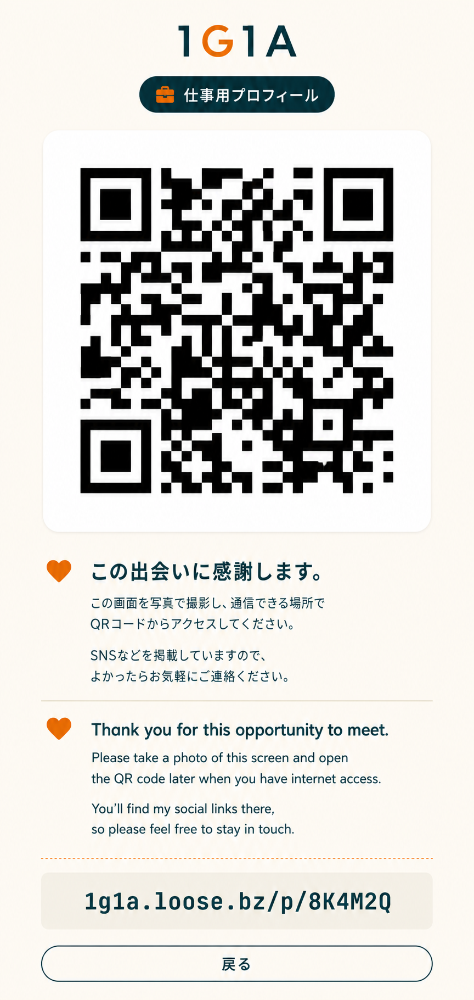
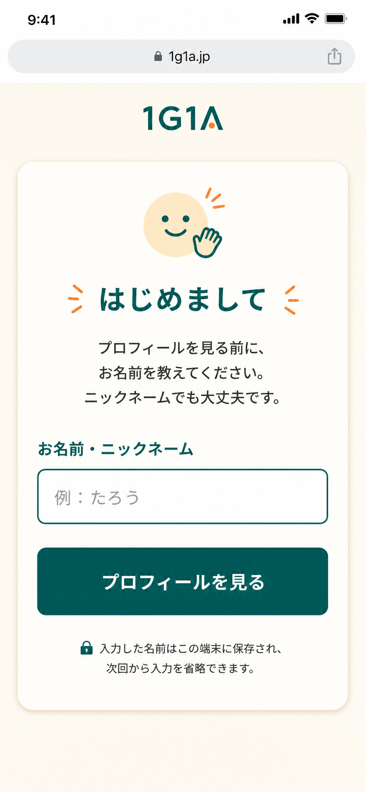
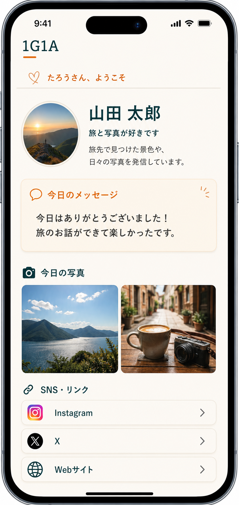

# 1G1A スマートフォン UI イメージ

1G1A は、ユーザーが人と会ったその場で「相手に見せたい共有プロフィール」を選び、QR で渡すためのサービスです。スマホ利用が中心なので、管理画面もゲスト画面も操作数を少なくし、画面ごとの目的をはっきり分けます。

## 共通UIルール

- ボタンは高さ・角丸・余白を共通化し、主要操作は塗りボタン、戻る・補助操作は白地ボタンで揃える
- オン／オフ設定や保存前の画像切り替えは、位置情報設定と同じスイッチUIに揃える。スイッチは説明を左、操作を右に置き、キーボードのフォーカスも見えるようにする
- ファイル選択は共通の枠とボタン見た目に整え、プロフィール画像とイベント写真で操作方法を統一する
- 共有プロフィール編集画面では、QR表示画面とゲスト公開プロフィール画面だけに適用するスキンを選べる。スキンはCSSとプレビュー画像を `public/skins/guest/<id>/` にまとめ、ID・表示名・説明を `skin.json` に記録する
- フォームの入力間隔、セクションカード、保存・戻るボタンの位置を揃え、スマートフォンで押しやすい幅を確保する

## ユーザー管理トップ

ログイン後、ユーザーが最初に開く画面です。

- まず「共有プロフィールを選ぶ」ことを最優先にする
- 次に「一言と写真を足す」
- 最後に大きな `QR を公開` ボタンを押す
- 表示させたい共有プロフィールは、プロフィール名と表示名を併記した選択欄から選ぶ
- 選択欄の下に、選択中プロフィールの画像、表示名、見出し、紹介文をプレビューする
- ページ幅は表示領域を基準に計算し、画面全体の横スクロールを発生させない
- 選択を変えると、選択中の共有プロフィール画像、公開表示名、見出し、紹介文を表示する。共有プロフィール画像が未設定の場合はアカウントプロフィール画像を表示する
- プロフィール編集は主操作にせず、プレビュー右上に小さな鉛筆アイコンで配置する。アイコンには読み上げ名とツールチップを付ける
- プロフィール編集画面には「戻る」を1つだけ置く。遷移元（QR作成、プロフィール一覧、共有プロフィールのゲストプレビュー）を保持し、保存後も同じ画面へ戻れるようにする。直接アクセス時は共有プロフィール一覧を戻り先にする
- ゲストページのスキンは、通常時は選択中の1件だけをプレビューする。「スキンを変更」で開く検索可能なカタログから選ぶ。候補数が増えても編集画面にカードが並び続けないようにする
- 広い画面ではプロフィール選択と確認を左カラム、メッセージ・写真・期限・位置情報・QR作成を右カラムに分ける。両カラムの余白と操作幅を揃え、狭い画面ではプロフィール、作成フォームの順に一列で表示する
- オフライン時だけQR作成ボタンの下に利用制約を表示する。「オフラインではQRを新しく作成できない」「期限内で以前この端末で開いたQRは表示できる」を短く伝え、オンラインへ復帰したら隠す
- 写真選択のファイル名と選択ボタンは左右に分け、位置情報スイッチと同じく「説明は左、操作は右」の配置に揃える
- 必要なら今回だけのコメントを追加する
- 必要なら写真を追加する。スマホではカメラ起動も想定する
- `QRを公開` で QR 表示画面へ進む
- 共有プロフィールはリスト形式で管理し、`+` から追加できる
- 左上の `1G1A` をタップするとQR作成、共有プロフィール管理、基本プロフィール、共有イベント、使い方、新着情報、ホーム画面への追加、ログアウトを開ける
- メニューは項目選択、メニュー外タップ、Escキーで閉じられる
- 共有イベント一覧は独立画面にする。メニューの「共有イベント」からは全プロフィール分を開き、共有プロフィール一覧の各カードにある「共有イベントを見る」からはそのプロフィールに紐づくイベントだけを開く。「共有イベント」の画面ヘッダーの下に、各行のヘッダーとして共有プロフィール名を表示する。ページングなしのリストで作成日時とメッセージ概要も確認でき、期限内の項目をタップするとQRを再表示する。期限切れの項目は履歴に残して「期限切れ」と表示し、タップできない
- 「使い方」はメニューから開き、共有プロフィール選択、QR作成、過去のQR再表示、PWA追加の手順を確認できる
- QR作成を押した後は、ボタンを処理中表示に変え、結果またはエラーをスマートフォンでも画面に表示する
- 写真を選ばずにQRを作成できる

## QR 表示画面

相手にその場で見せる画面です。QR を直接読み取れない場合や、ネットワークが不安定な場所でも、画面を写真で撮ってあとからアクセスできることを前提にします。

- QR は撮影しやすい大きさと高いコントラストで表示する
- 日本語と英語で、写真に残してあとからアクセスできることを説明する
- 短い URL も表示する
- QR 表示時にブラウザの位置情報許可を求め、許可された場合は緯度・経度・精度を保存する
- QR表示の配色は、紐づく共有プロフィールに設定されたスキンを使う。QRコード自体は読み取りやすさのため白地・黒の高コントラストを維持する
- 位置情報の保存に失敗しても QR 表示は止めない
- 位置情報は管理者本人だけが確認でき、公開ページやゲスト画面には出さない

表示メッセージ案:

```text
この出会いに感謝。
このQRを写真で撮っておくと、あとからSNSなどの連絡先を確認できます。

Thank you for this encounter.
Please take a photo of this QR code so you can visit my profile later.

QR 画面には詳細ボタンを置かず、見せることに集中する。画面下部にはダッシュボードへ戻るアイコンを1つ置く。
```



## ゲスト初回名前入力画面

ゲストが QR から初めてアクセスしたときの画面です。Cookie を確認し、未登録なら名前またはニックネームを入力してもらいます。

- 入力項目はニックネームのみ
- ボタンは `次へ` だけにする
- 初回以外は入力画面を出さず、保存済みの名前でプロフィール画面へ進む
- ログインは要求しない
- ゲスト名は相手を特定しすぎないよう、自由なニックネームでもよい



## ゲスト公開プロフィール画面

ゲストが名前入力後、または2回目以降に見る画面です。ゲストには編集ボタンや管理リンクを表示せず、共有されたプロフィール・今回のメッセージ・写真・SNS リンクだけを見せます。ログイン中の所有者プレビューでは、プロフィールブロックに対象プロフィールの編集ボタンを表示します。

- 冒頭に `○○さん、ようこそ` と表示する
- 共有プロフィールの名前、見出し、紹介文を表示する
- 今回だけのコメントは `今日のメッセージ` として目立たせる
- 今回追加した写真は `今日の写真` として表示する
- SNS や Web サイトへのリンクは大きなタップ領域にする
- ゲスト画面には QR、プロフィール選択、編集・管理、ログイン導線を置かない
- ゲスト画面の配色は紐づく共有プロフィールのスキンに従う。スキン選択画面ではなく、プロフィール編集画面で設定する


